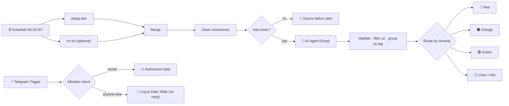

<div align="center">

# 🛰️ NGP-018 · Subdomain Recon Digest Bot

**A passive recon automation built in n8n: it reads public certificate-transparency logs every morning, lets an AI agent tag and prioritise each subdomain, and sends a colour-coded digest to Telegram, to its owner only.**


</div>

---

## 📌 Overview

Forgotten, old or half-configured subdomains (`dev`, `staging`, `admin`, `svn` …) are a favourite starting point for attackers. Every public HTTPS certificate is permanently written to **Certificate Transparency (CT) logs**, so those names stay visible long after a server is abandoned.

This workflow turns that public data into a **daily, prioritised alert**:

| | |
|---|---|
| **Target domain** | `nmap.org` |
| **Schedule** | Every day at **09:18 IST** (Asia/Kolkata) |
| **Data sources** | [ctlogs.dev](https://ctlogs.dev) (primary) · [crt.sh](https://crt.sh) (optional second source) |
| **AI** | n8n AI Agent + Groq `openai/gpt-oss-20b` |
| **Output** | Telegram, only hosts with **priority ≥ 2**, grouped by tag |
| **Access control** | Only the owner's chat ID is served; everyone else is ignored and logged |
| **Personal tag** | `NGP-018` |

> 🔒 **It never touches the target.** The bot only reads public CT records. No port scans, no probing, no requests to the target's servers.

---

## 🖼️ Workflow




---

## ✨ Features

- **Scheduled** daily run at 09:18 IST, with the timezone set in the workflow settings.
- **Resilient data collection:** two CT sources in parallel; one failing does not stop the run (timeouts + retries).
- **Format-agnostic cleaning:** extracts hostnames from any JSON shape, lowercases, **removes duplicates and wildcard (`*`) entries**, rejects lookalike domains such as `nmap.org.evil.com`.
- **AI classification:** every host gets a **tag** (`admin` / `dev` / `staging` / `api` / `other`), a **priority 1-5** and a **one-line reason**. Hosts are sent in batches of 30 to stay inside Groq rate limits.
- **Output validation:** hosts are matched by name, invalid tags or priorities are rejected, and risky wording in reasons is neutralised before anything reaches you.
- **F3 · Severity routing:** a **Switch** node sends 🔴 red / 🟠 orange / 🟢 green results through three different Telegram templates.
- **S4 · Access control:** an allowlist check on **every inbound message** (chat ID + sender ID + private chat). Strangers get **no reply** and are **logged** in an n8n Data Table.
- **Never silent:** you get a "CLEAR" message when nothing is interesting, an "AI FAILURE" message if classification fails, and a "SOURCE FAILURE" message if both data sources are down.
- Long digests are **split automatically** under Telegram's 4096-character limit.

---

## 🎯 Priority scale

Priority is a **triage hint from the hostname text only**. It is not proof of a vulnerability.

| Priority | Meaning | Example | Route |
|:---:|---|---|:---:|
| **5** | Clearly an admin / management interface | `admin.example.org` | 🔴 Red |
| **4** | Strong sensitive keyword (login, vpn, sso, internal tools) | `vpn.example.org` | 🔴 Red |
| **3** | Clear dev / test / staging / API role | `dev.`, `staging.`, `api.` | 🟠 Orange |
| **2** | Weak hint of a special-purpose host | `svn.example.org` | 🟢 Green |
| **1** | Ordinary public host | `www.`, `mail.`, `docs.` | *not sent* |

---

## 💬 Telegram output

Every message follows the required format:

```
<emoji> NGP-018 | exec #<execution id> | <IST time> | <verdict / severity> | <one-line summary>
```

Example (orange route):

```
🟠 NGP-018 | exec #43 | 14-Oct-2026 09:42:50 IST | ORANGE / MEDIUM | 1 host(s) priority 3 on nmap.org

DEV (1)
• svn.nmap.org P3 — contains svn

📊 1 hosts scanned | 1 classified | 0 failed validation
```

<p align="center"></p>

| Route | Priority | Heading |
|---|:---:|---|
| 🔴 Red | 4-5 | `RED / HIGH` · "Review first" |
| 🟠 Orange | 3 | `ORANGE / MEDIUM` |
| 🟢 Green | 2 | `GREEN / LOW` · "FYI (low signal)" |
| ⚪ Clear / ⚠️ AI failure | none | `CLEAR / none` or `AI FAILURE / check` |

---

## 🧩 Node-by-node

| # | Node | What it does |
|:---:|---|---|
| 1 | **Schedule Trigger 09:18 IST** | Starts the workflow daily |
| 2 | **CT Source · ctlogs.dev** | Fetches subdomains (60 s timeout, 3 retries) |
| 3 | **CT Source · crt.sh** | Optional second source; allowed to fail |
| 4 | **Merge CT Sources** | Combines both responses |
| 5 | **Clean Hostnames** | Extracts, normalises, filters wildcards and out-of-scope names, dedupes, batches by 30 |
| 6 | **Has Hosts?** | Yes → AI · No → failure alert |
| 7 | **AI Agent + Groq Chat Model** | Tags and prioritises each host (temperature 0) |
| 8 | **Parse, Validate, Filter ≥2 and Group** | Validates AI JSON, drops priority 1, groups by tag, assigns severity |
| 9 | **Route by Severity** | Switch: red / orange / green / clear |
| 10 | **Red · Orange · Green · Clear Telegram** | Four different message templates |
| 11 | **Telegram Trigger** | Listens for inbound messages |
| 12 | **Check Chat ID (Allowlist)** | Owner only: chat ID + sender ID + private chat |
| 13 | **Authorized Reply** | Owner gets "AUTHORIZED / bot online" |
| 14 | **Log Unauthorized Attempt** | Everyone else: silent, logged to Data Table |

---

## 🚀 Setup

### Prerequisites

- n8n (cloud or self-hosted) with **AI Agent** and **Data Tables** available
- A **Telegram bot** (token from [@BotFather](https://t.me/BotFather))
- A **Groq API key** ([console.groq.com](https://console.groq.com))
- Your **Telegram chat ID** (message [@userinfobot](https://t.me/userinfobot) to read it)

### 1 · Import

`Workflows → Import from file` → choose `workflow/NGP-018_Subdomain_Recon_Digest_Bot_FIXED.json`.

### 2 · Create credentials in n8n

| Credential | Used by |
|---|---|
| **Telegram API** (bot token) | Telegram Trigger and all Telegram send nodes |
| **Groq API** (API key) | Groq Chat Model |

The exported JSON contains **no credentials**, so after importing, open the Telegram Trigger, the six Telegram send nodes and the Groq Chat Model and **select your credential** on each. **Never commit API keys or tokens to this repo.**

### 3 · Create the Data Table

Create a table named **`NGP-018 Unauthorized Access Log`** with these columns, then **select it** in the **Log Unauthorized Attempt** node (the file ships with the placeholder `YOUR_DATA_TABLE_ID`):

| Column | Type |
|---|---|
| `attempted_at` | date/time |
| `chat_id` | string |
| `user_id` | string |
| `username` | string |
| `command` | string |
| `outcome` | string |

### 4 · Set your chat ID

The file ships with the placeholder **`YOUR_TELEGRAM_CHAT_ID`**. Replace it with **your own chat ID** in:

- the **Check Chat ID (Allowlist)** node (two conditions: chat ID and sender ID)
- all six Telegram send nodes: Source Failure, Red, Orange, Green, Clear / Info, Authorized Reply

### 5 · Webhook (self-hosted only)

The Telegram Trigger needs a public **HTTPS** URL. Running locally? Expose n8n with a tunnel (e.g. ngrok) and set `WEBHOOK_URL`.

### 6 · Check the timezone, test, then activate

Open **Workflow settings** and confirm **Timezone = Asia/Kolkata**, so the schedule really fires at 09:18 IST.

1. Open the Schedule Trigger node and click **Execute workflow**. You should receive the digest on Telegram.
2. Message the bot from a **second Telegram account**. There should be **no reply** and a **new row** in the log table.
3. Toggle the workflow to **Active**. Only one active workflow per bot token can own the Telegram webhook, so deactivate any older version first.

---

## ⚙️ Configuration

| What | Where | Default |
|---|---|---|
| Run time | Schedule Trigger | 09:18 (timezone `Asia/Kolkata`) |
| Target domain | `DOMAIN` in **Clean Hostnames**, both source URLs | `nmap.org` |
| Batch size per AI call | `CHUNK` in **Clean Hostnames** | 30 |
| AI model | Groq Chat Model | `openai/gpt-oss-20b`, temperature 0 |
| Priority rubric | AI Agent → System Message | see [Priority scale](#-priority-scale) |
| Alert cutoff | **Parse, Validate, Filter ≥2 and Group** | priority ≥ 2 |

> Hit Groq rate limits (HTTP 429) on a big domain? Lower `CHUNK`, raise retries, or use a larger Groq model.

---

## 🔐 Security notes

- **Passive only.** Reads public CT data. Nothing is scanned or probed.
- **Allowlist on every inbound message:** chat ID, sender ID and `private` chat type must all match.
- **Strangers are ignored, not answered**, so the bot reveals nothing about itself, and each attempt is logged.
- **Secrets stay in n8n credentials.** The published JSON contains no API keys, tokens, credential IDs or personal chat ID, only the placeholder `YOUR_TELEGRAM_CHAT_ID`. Until you replace it, the allowlist matches nobody, so the bot is closed by default.
- AI output is **validated before use**. Claims such as "compromised" or "vulnerable" are never passed through as findings.

---

## ⚠️ Limitations

- The AI judges **only the hostname text**. `admin.` does not prove an exposed panel, and `www.` does not prove safety.
- A borderline name (for example `svn`) can land on **priority 2 or 3** between runs.
- CT logs list hosts that **ever** had an HTTPS certificate. An entry can be old or dead, and the bot does not check whether the host is alive.
- Wildcard certificates hide individual hostnames, so those names cannot be found this way.
- The size of the digest depends on what the CT sources return for the domain.

---

## ⚖️ Ethical use

This project is for **education and authorised security work**. It uses public data only. Do not use any findings against systems you do not own or have written permission to test. `nmap.org` is used because it is a well-known public domain.

---

## 📁 Repository structure

```
.
├── README.md
├── workflow/
│   └── NGP-018_Subdomain_Recon_Digest_Bot_FIXED.json
├── docs/
│   └── NGP018_Subdomain_Recon_Digest_Bot_Abstract.docx
└── images/
    ├── workflow.png
    └── telegram-output.png
```

---

## 🛠️ Built with

[n8n](https://n8n.io) · [Groq](https://groq.com) · [Telegram Bot API](https://core.telegram.org/bots/api) · [ctlogs.dev](https://ctlogs.dev) · [crt.sh](https://crt.sh)

---

## 👤 Author

**Jafeef Ahamed S**: Red Team · Recon & OSINT · Tag `NGP-018`

<div align="center">

⭐ If this helped you, consider starring the repo.

</div>
